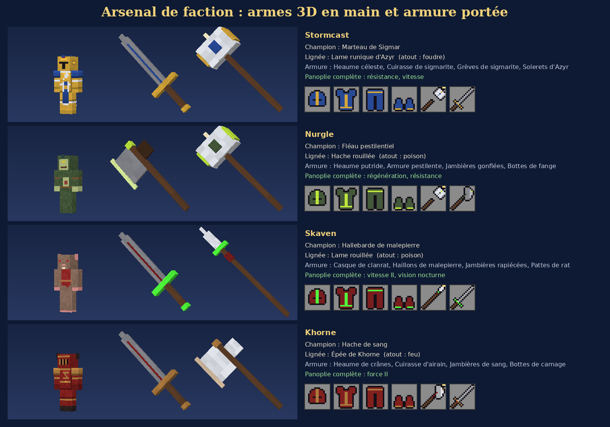

# Royaumes Mortels — Warhammer Age of Sigmar pour Minecraft

Mod NeoForge pour **Minecraft Java 26.3** (NeoForge 26.3.0.115, GeckoLib 5.5.7, Java 25).
Le mod embarque son datapack : il suffit d'installer le `.jar` (ou le modpack `.mrpack`) sur le client et le serveur.

## En jeu

**Serment d'allégeance.** À la première connexion, l'écran de serment s'ouvre : 25 factions rangées par Grande
Alliance (Ordre, Chaos, Mort, Destruction). Le panneau de droite montre le skin de la faction, son Royaume d'origine,
ses dons et son fardeau. « Prêter serment » applique la faction **et son skin** (visible par les autres joueurs qui ont le mod).
Touche **J** : rouvrir l'écran.

**Magie des huit Vents.** Huit bâtons (Azyr, Aqshy, Ghur, Ghyran, Hysh, Ulgu, Shyish, Chamon), deux sorts chacun :
clic droit = sort mineur, accroupi + clic droit = grand sort. L'énergie arcanique (100 + 5 par niveau) se recharge de
2 par seconde, 4 dans le Royaume de sa faction. Chaque sort coûte moitié moins dans le Royaume de son Vent.
Cristal arcanique : +40. Autel arcanique : recharge complète (une fois par minute).

**Capacité de faction (touche R).** Chaque faction a la sienne : Frappe de foudre (Stormcast), Waaagh ! (Ironjawz,
deux brutes alliées), Fuite par la Warp (Skaven), Miasme (Nurgle), Piétinement (Behemat)… Gratuite, 25 à 90 s de recharge,
affichée sur l'écran de serment et dans le HUD.

**Saga des Royaumes.** Un onglet de progrès guide le joueur : serment, pierre des Royaumes, premier bâton et premier sort,
les huit Royaumes et les Huit-Points, les six seigneurs (Nagash, Archaon, Gordrakk, Skarbrand, Thanquol, Rotigus).

**Camp de guerre.** Pose un **Étendard de camp** (bannière + lingot d'or + pierre des Royaumes) : il fonde ton camp,
et un clic droit ouvre l'écran du camp. Dépose ton butin (lingots, gemmes, pierre des Royaumes, cristaux), recrute
des unités de ta faction (plus de types et de places à chaque niveau, 5 niveaux), donne-leur l'ordre de garder le camp
ou de te suivre, et envoie-les en raid : Pillage (2 min), Assaut (5 min) ou Croisade (10 min). Selon leur force, elles
reviennent victorieuses avec du butin, de la pierre des Royaumes, des cristaux et de la gloire, ou décimées. Dès le
niveau 2, des bandes d'une alliance ennemie attaquent ton camp toutes les 20 à 30 minutes.

**Monde de base et Royaumes.** Le camp de guerre se fonde dans le monde de base (Overworld), qui garde sa génération et ses
monstres vanilla. Chaque Royaume a ses richesses et ses manques (Chamon : or, fer, cuivre ; Hysh : diamants, émeraudes ; Aqshy :
charbon, redstone, or…) et un minerai propre qui donne l'éclat de son Vent (malepierre dans les Huit-Points).

**Équilibrage.** Les guerriers de faction apparaissent une fois sur trois au plus, jamais plus de six à la fois dans un rayon
de 32 blocs, ne repèrent un héros qu'à 16 blocs, épargnent les héros de niveau inférieur à 5 tant qu'ils ne sont pas
attaqués, et frappent les joueurs 25 % moins fort. Les seigneurs n'apparaissent jamais naturellement.

**Les six seigneurs.** Un Œil (œil de l'Ender + deux éclats du Royaume + pierre des Royaumes) montre la direction de l'antre.
Au cœur de l'antre, l'Autel des Seigneurs éveille le sceau forgé : le seigneur apparaît. Vaincu, il lâche sa relique unique :
Sceptre de Nagash (Armée des Morts, Main de Nagash), Pourfendeuse des Rois d'Archaon, Krokfendeur de Gordrakk, Massacre et
Carnage de Skarbrand, Bâton de malefeu de Thanquol, Bâton de pluie de Rotigus.

**Arsenal et Forge de guerre (0.12).** 410 objets, tous forgés à la **Forge de guerre** (or, enclume, obsidienne, pierre
des Royaumes), qui n'ouvre que l'arsenal de TA faction et de TON alliance. Les recettes exigent les éclats de **deux Royaumes
étrangers** au tien. Trois paliers, chacun forgé à partir de la pièce du palier précédent (refondue) :
- **Soldat** (fer + 1 éclat) → **Élite** (pièce Soldat + diamants + éclats) → **Légende** (pièce Élite + netherite + éclats + pierre).
- **Armure de faction** en 4 pièces par palier (défense fer / diamant / au-delà de la netherite). Panoplie complète portée par un
  héros de la faction : Soldat = premier effet, Élite = tous les effets, Légende = tous les effets un niveau au-dessus.
- **Outils d'alliance** (pioche, pelle, hache, houe, épée), communs aux factions d'une Grande Alliance, chacune avec sa forme et ses
  métaux (Ordre : acier, sigmarite, or ; Chaos : fer noir, airain, métal démoniaque ; Mort : os, fer de tombe, nadirite ;
  Destruction : fer rouillé, bronze brut, ferraille Waaagh), avec un effet en main
  qui monte avec le palier : Ordre (célérité, vitesse, résistance, régénération ; épée affaiblissante, foudre en Légende),
  Chaos (célérité, résistance au feu, force, chance ; épée de feu), Mort (vision nocturne, célérité, résistance, chance ;
  épée vampirique), Destruction (célérité, vitesse, force, vie bonus ; épée qui projette).
- **Armes de faction** : arme de lignée (atout à chaque coup) puis arme de champion, forgée à partir de l'arme de lignée
  (très puissante, atout une fois sur quatre). Modèles 3D en main.

**Les Royaumes.** Huit Royaumes et les Huit-Points, chacun avec ses biomes, ses structures et ses factions.
On y voyage par les failles du datapack ou par le **Portail des Royaumes** (bloc). En entrant dans un Royaume,
la barre d'action rappelle quel Vent y souffle.

**Menu créatif.** Cinq onglets : Armes et armures, Magie, Blocs des Royaumes, Créatures (148 œufs), Montures et voyage.

**HUD.** Jauge d'énergie (bas gauche), blason, faction, niveau et Royaume (haut gauche), sort prêt au-dessus de la
barre d'objets quand on tient un bâton. L'inventaire de survie reste la « table de taverne » (Codex, Forge, Blocs, Héros).

## Aides visuelles

| | |
|---|---|
|  |  |
|  |  |
|  |  |
|  |  |

## Générateurs (dossier `outils/`)

- `objets/arsenal.py` : arsenal des factions (armes 3D, icônes, armures portées, recettes, `ArsenalGenere.java`).

Tout le contenu graphique et les listes Java sont générés par des scripts Python (Pillow) :

| Script | Produit |
|---|---|
| `outils/objets/minerais.py` | répartition des minerais vanilla par Royaume (à lancer après le datapack) |
| `outils/objets/batiments.py` | plans des 5 bâtiments du camp, 3 niveaux, 4 styles d'alliance |
| `outils/objets/capacites.py`, `saga.py` | capacités des 25 factions, onglet de progrès Saga des Royaumes |
| `outils/objets/objets.py` | objets, blocs, œufs : textures, modèles, butins, recettes, étiquettes, minerai, traductions, `ContenuGenere.java`, contenu des onglets créatifs |
| `outils/skins/skins.py` | skins des 25 factions + planche |
| `outils/gui/aos.py` | blasons, ornements, jauge et icônes des Vents |
| `outils/gui/taverne.py` | textures de l'inventaire de taverne |
| `outils/modeles/*.py` | modèles GeckoLib des créatures et montures |
| `outils/visuels/*.py` | carte, maquettes et guides |
| `outils/generateur/` | générateur du datapack (factions, Royaumes, structures, Codex) |

La version 0.6 (avant la refonte) est conservée sur la branche `archive/v0.6`.
