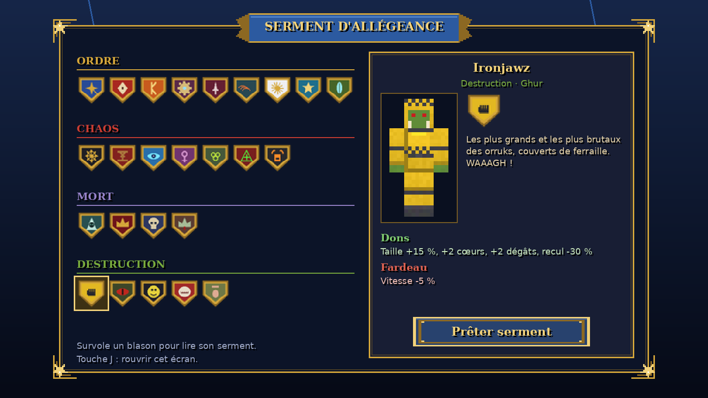
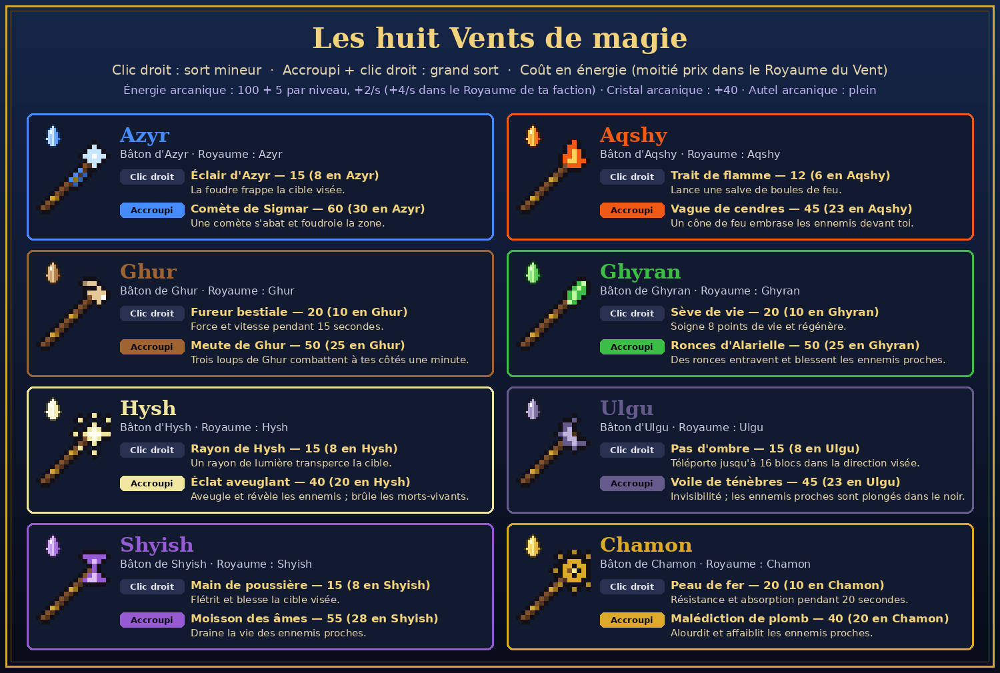
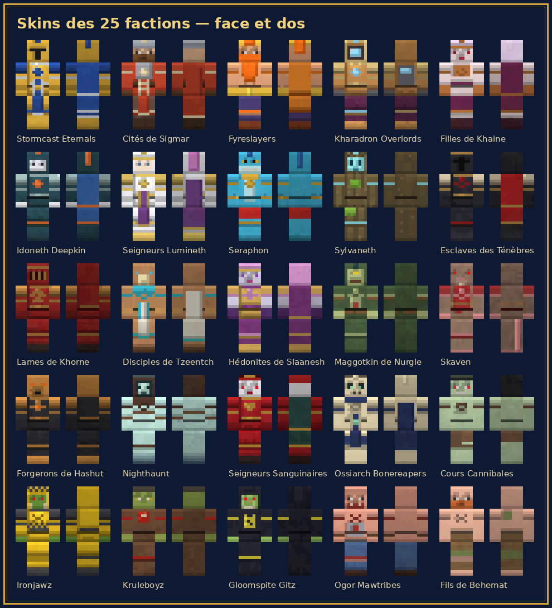

# Royaumes Mortels — Warhammer Age of Sigmar pour Minecraft

Mod NeoForge pour **Minecraft Java 26.3** (NeoForge 26.3.0.115, GeckoLib 5.5.7, Java 25).
Le mod embarque son datapack : il suffit d'installer le `.jar` (ou le modpack `.mrpack`) sur le client et le serveur.

## En jeu

**Serment d'allégeance.** À la première connexion, l'écran de serment s'ouvre : 25 factions rangées par Grande
Alliance (Ordre, Chaos, Mort, Destruction). Le panneau de droite montre le skin de la faction, son Royaume d'origine,
ses dons et son fardeau. « Prêter serment » applique la faction **et son skin** (visible par les autres joueurs qui ont le mod).
Touche **J** : rouvrir l'écran.

**Magie des huit Vents.** Huit bâtons (Azyr, Aqshy, Ghur, Ghyran, Hysh, Ulgu, Shyish, Chamon), deux sorts chacun :
clic droit = sort mineur, accroupi + clic droit = grand sort. L'énergie arcanique (100 + 5 par niveau) se recharge de
2 par seconde, 4 dans le Royaume de sa faction. Chaque sort coûte moitié moins dans le Royaume de son Vent.
Cristal arcanique : +40. Autel arcanique : recharge complète (une fois par minute).

**Capacité de faction (touche R).** Chaque faction a la sienne : Frappe de foudre (Stormcast), Waaagh ! (Ironjawz,
deux brutes alliées), Fuite par la Warp (Skaven), Miasme (Nurgle), Piétinement (Behemat)… Gratuite, 25 à 90 s de recharge,
affichée sur l'écran de serment et dans le HUD.

**Saga des Royaumes.** Un onglet de progrès guide le joueur : serment, pierre des Royaumes, premier bâton et premier sort,
les huit Royaumes et les Huit-Points, les six seigneurs (Nagash, Archaon, Gordrakk, Skarbrand, Thanquol, Rotigus).

**Les Royaumes.** Huit Royaumes et les Huit-Points, chacun avec ses biomes, ses structures et ses factions.
On y voyage par les failles du datapack ou par le **Portail des Royaumes** (bloc). En entrant dans un Royaume,
la barre d'action rappelle quel Vent y souffle.

**Menu créatif.** Cinq onglets : Armes et armures, Magie, Blocs des Royaumes, Créatures (148 œufs), Montures et voyage.

**HUD.** Jauge d'énergie (bas gauche), blason, faction, niveau et Royaume (haut gauche), sort prêt au-dessus de la
barre d'objets quand on tient un bâton. L'inventaire de survie reste la « table de taverne » (Codex, Forge, Blocs, Héros).

## Aides visuelles

| | |
|---|---|
|  |  |
|  |  |
|  |  |

## Générateurs (dossier `outils/`)

Tout le contenu graphique et les listes Java sont générés par des scripts Python (Pillow) :

| Script | Produit |
|---|---|
| `outils/objets/capacites.py`, `saga.py` | capacités des 25 factions, onglet de progrès Saga des Royaumes |
| `outils/objets/objets.py` | objets, blocs, œufs : textures, modèles, butins, recettes, étiquettes, minerai, traductions, `ContenuGenere.java`, contenu des onglets créatifs |
| `outils/skins/skins.py` | skins des 25 factions + planche |
| `outils/gui/aos.py` | blasons, ornements, jauge et icônes des Vents |
| `outils/gui/taverne.py` | textures de l'inventaire de taverne |
| `outils/modeles/*.py` | modèles GeckoLib des créatures et montures |
| `outils/visuels/*.py` | carte, maquettes et guides |
| `outils/generateur/` | générateur du datapack (factions, Royaumes, structures, Codex) |

La version 0.6 (avant la refonte) est conservée sur la branche `archive/v0.6`.
