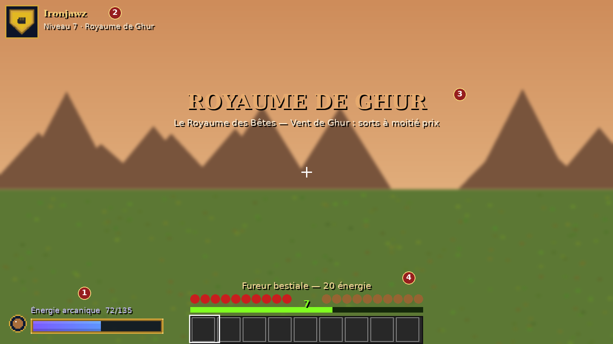
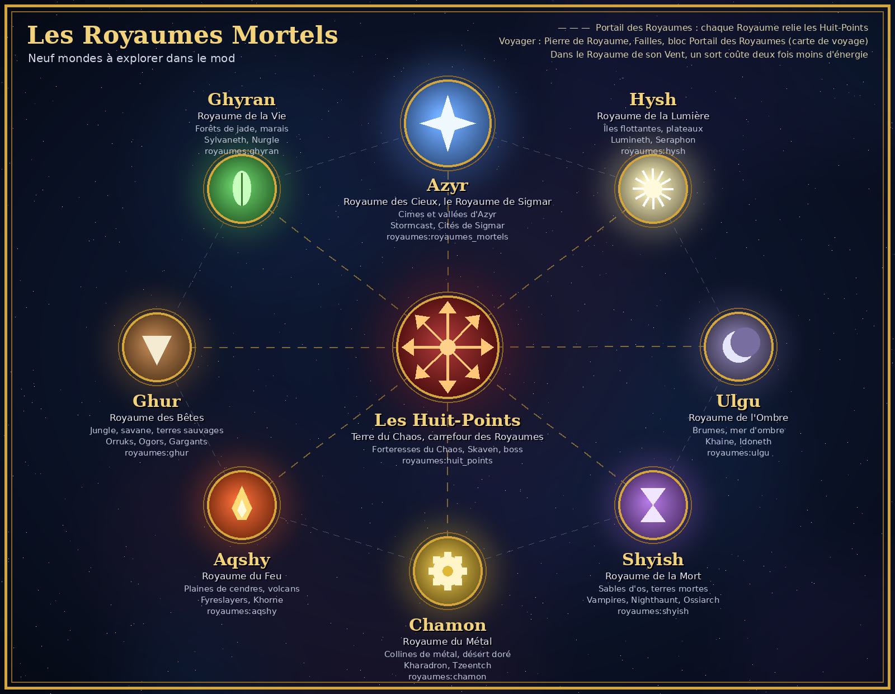
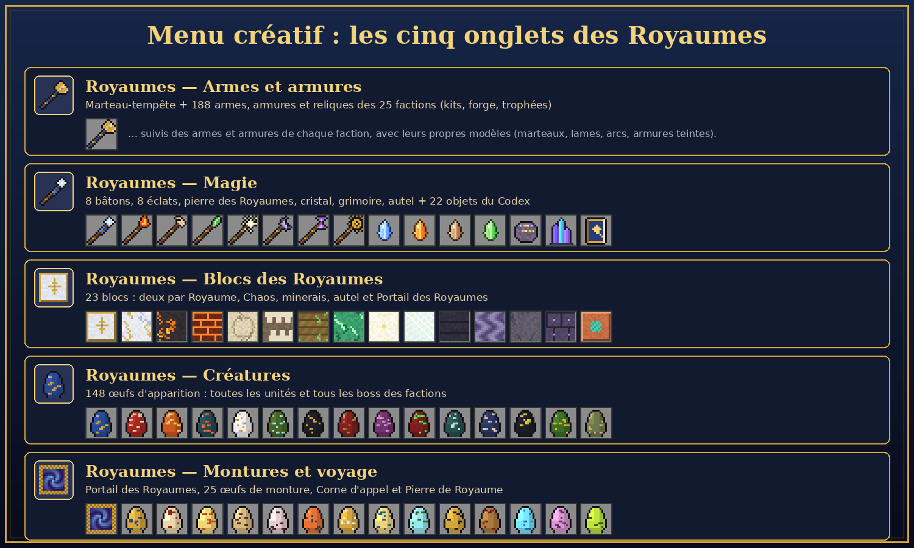
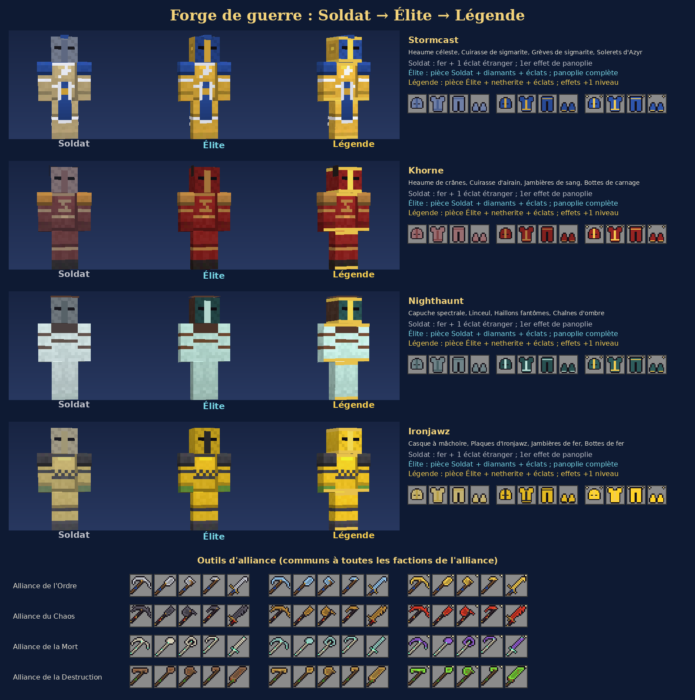
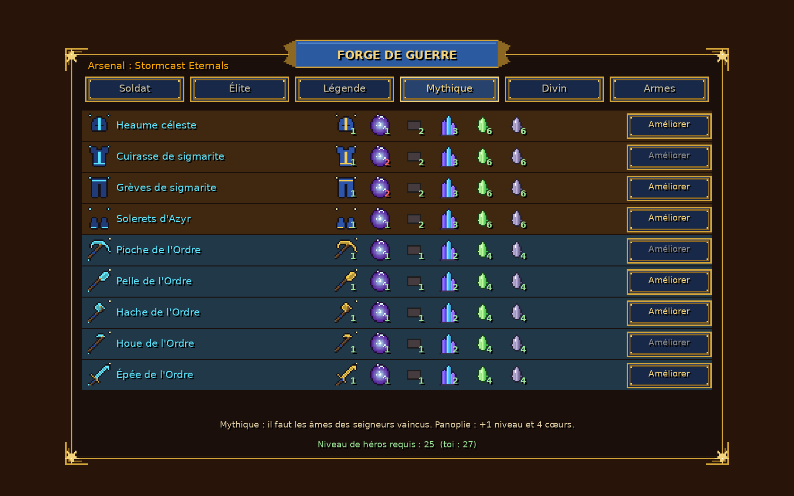
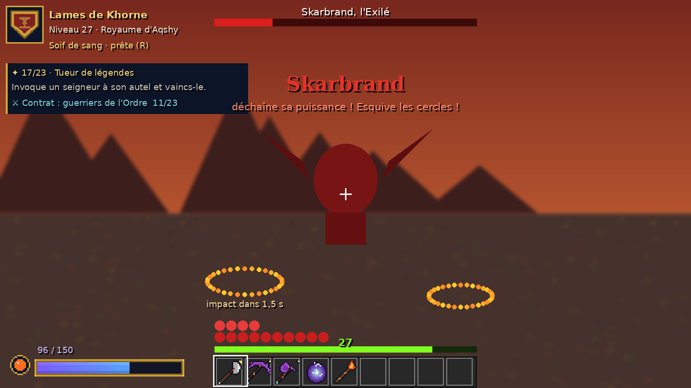
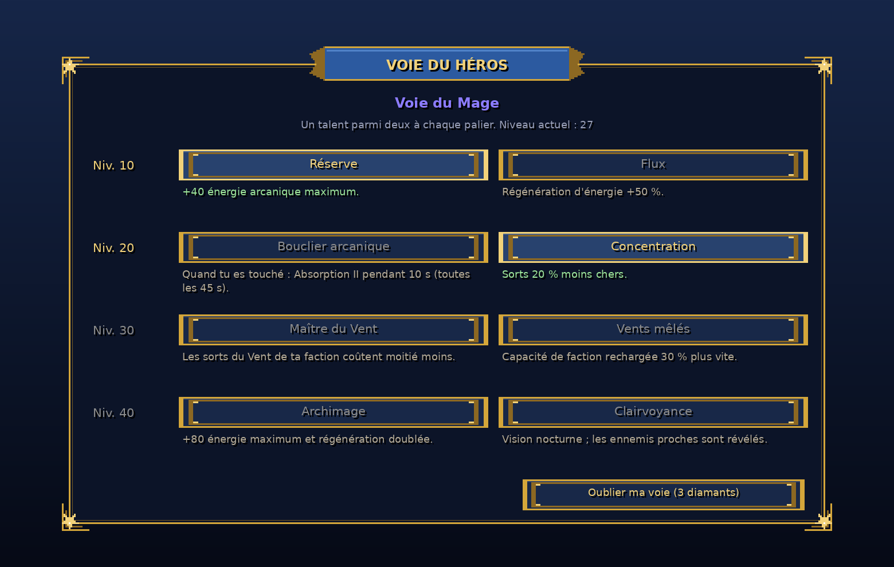
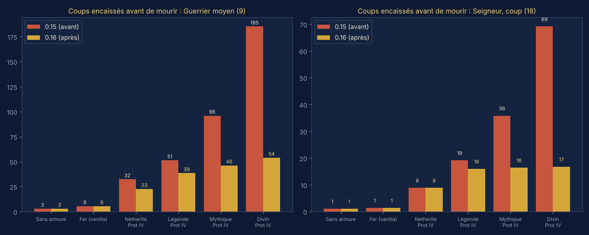
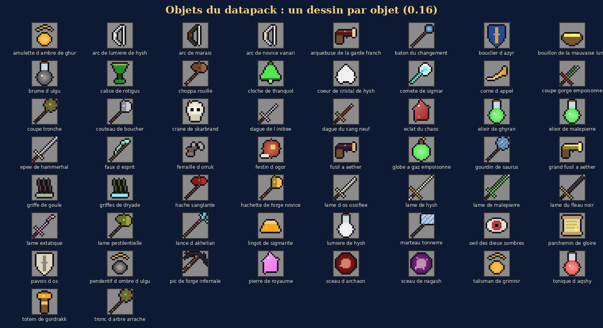

# Royaumes Mortels — Warhammer Age of Sigmar pour Minecraft

Mod NeoForge pour **Minecraft Java 26.3** (NeoForge 26.3.0.115, GeckoLib 5.5.7, Java 25).
Le mod embarque son datapack : il suffit d'installer le `.jar` (ou le modpack `.mrpack`) sur le client et le serveur.

## En jeu

**Serment d'allégeance.** À la première connexion, l'écran de serment s'ouvre : 25 factions rangées par Grande
Alliance (Ordre, Chaos, Mort, Destruction). Le panneau de droite montre le skin de la faction, son Royaume d'origine,
ses dons et son fardeau. « Prêter serment » applique la faction **et son skin** (visible par les autres joueurs qui ont le mod).
Touche **J** : rouvrir l'écran.

**Magie des huit Vents.** Huit bâtons (Azyr, Aqshy, Ghur, Ghyran, Hysh, Ulgu, Shyish, Chamon), deux sorts chacun :
clic droit = sort mineur, accroupi + clic droit = grand sort. L'énergie arcanique (100 + 5 par niveau) se recharge de
2 par seconde, 4 dans le Royaume de sa faction. Chaque sort coûte moitié moins dans le Royaume de son Vent.
Cristal arcanique : +40. Autel arcanique : recharge complète (une fois par minute).

**Capacité de faction (touche R).** Chaque faction a la sienne : Frappe de foudre (Stormcast), Waaagh ! (Ironjawz,
deux brutes alliées), Fuite par la Warp (Skaven), Miasme (Nurgle), Piétinement (Behemat)… Gratuite, 25 à 90 s de recharge,
affichée sur l'écran de serment et dans le HUD.

**Saga des Royaumes.** Un onglet de progrès guide le joueur : serment, pierre des Royaumes, premier bâton et premier sort,
les huit Royaumes et les Huit-Points, les six seigneurs (Nagash, Archaon, Gordrakk, Skarbrand, Thanquol, Rotigus).

**Camp de guerre.** Pose un **Étendard de camp** (bannière + lingot d'or + pierre des Royaumes) : il fonde ton camp,
et un clic droit ouvre l'écran du camp. Dépose ton butin (lingots, gemmes, pierre des Royaumes, cristaux), recrute
des unités de ta faction (plus de types et de places à chaque niveau, 5 niveaux), donne-leur l'ordre de garder le camp
ou de te suivre, et envoie-les en raid : Pillage (2 min), Assaut (5 min) ou Croisade (10 min). Selon leur force, elles
reviennent victorieuses avec du butin, de la pierre des Royaumes, des cristaux et de la gloire, ou décimées. Dès le
niveau 2, des bandes d'une alliance ennemie attaquent ton camp toutes les 20 à 30 minutes.

**Monde de base et Royaumes.** Le camp de guerre se fonde dans le monde de base (Overworld), qui garde sa génération et ses
monstres vanilla. Chaque Royaume a ses richesses et ses manques (Chamon : or, fer, cuivre ; Hysh : diamants, émeraudes ; Aqshy :
charbon, redstone, or…) et un minerai propre qui donne l'éclat de son Vent (malepierre dans les Huit-Points).

**Équilibrage.** Les guerriers de faction apparaissent une fois sur trois au plus, jamais plus de six à la fois dans un rayon
de 32 blocs, ne repèrent un héros qu'à 16 blocs, épargnent les héros de niveau inférieur à 5 tant qu'ils ne sont pas
attaqués, et frappent les joueurs 25 % moins fort. Les seigneurs n'apparaissent jamais naturellement.

**Les six seigneurs.** Un Œil (œil de l'Ender + deux éclats du Royaume + pierre des Royaumes) montre la direction de l'antre.
Au cœur de l'antre, l'Autel des Seigneurs éveille le sceau forgé : le seigneur apparaît. Vaincu, il lâche sa relique unique :
Sceptre de Nagash (Armée des Morts, Main de Nagash), Pourfendeuse des Rois d'Archaon, Krokfendeur de Gordrakk, Massacre et
Carnage de Skarbrand, Bâton de malefeu de Thanquol, Bâton de pluie de Rotigus.

**Arsenal et Forge de guerre.** 675 objets, tous forgés à la **Forge de guerre** (or, enclume, obsidienne, pierre des
Royaumes), qui n'ouvre que l'arsenal de TA faction et de TON alliance et exige un **niveau de héros** par palier. Cinq paliers,
chacun forgé à partir de la pièce du palier précédent (refondue) :

| Palier | Niveau | Coût principal | Défense de l'armure | Panoplie complète |
|---|---|---|---|---|
| Soldat | 1 | fer + pierre des Royaumes | 15 (fer) | premier effet de faction |
| Élite | 8 | diamants + éclats de deux Royaumes étrangers | 20 (diamant) | tous les effets |
| Légende | 16 | netherite + cristal arcanique + éclats | 24, robustesse 4 | +1 niveau d'effets |
| Mythique | 25 | **âmes de seigneur** + netherite + éclats | 27, robustesse 5 | +1 niveau, +4 cœurs |
| Divin | 35 | **étoile du Nether** + âmes + netherite + éclats | 30 (le maximum du jeu), robustesse 6 | +2 niveaux, +8 cœurs, régénération |

- **Outils d'alliance** (pioche, pelle, hache, houe, épée) sur les mêmes cinq paliers, avec des métaux au-dessus de la netherite
  (Légende 2800 utilisations, Mythique 3800, Divin 5200 et minage 2× plus rapide). Chaque alliance a sa forme et ses métaux
  (Ordre : acier, sigmarite, or, aether, étoile d'Azyr ; Chaos : fer noir, airain, métal démoniaque, warpfer, feu des Dieux ;
  Mort : os, fer de tombe, nadirite, âme, pâleur de Nagash ; Destruction : rouille, bronze, ferraille Waaagh, ferraille de feu,
  or de Gork) et un effet en main qui monte avec le palier.
- **Armes de faction** : lignée (niv. 8, atout à chaque coup) → champion (niv. 16, atout 1 coup sur 4) → **ascension** (niv. 35,
  étoile du Nether et 4 âmes, atout 1 coup sur 2 renforcé). Modèles 3D en main.
- **Âmes de seigneur** : 2 à 3 par seigneur vaincu, +1 par héros supplémentaire au combat.

**Saga du Héros (0.14).** 24 quêtes avec une astuce chacune qui servent de fil rouge et de tutoriel, affichées en haut à gauche avec leur progrès :
serment, armure Soldat, premier Royaume (Pierre de Royaume du kit), premier sang, camp, bâtiment, Forge de guerre, magie, capacité,
niveau 8, voie, éclat étranger, Élite, raid, Œil de seigneur, premier seigneur, Légende, Mythique, Divin, jusqu'à l'**Ascension** de ton arme. Chaque étape rapporte de la
gloire et des objets. Ensuite, des **Contrats de chasse** renouvelables (abattre N guerriers d'une alliance ennemie) récompensent
gloire, éclats et pierre des Royaumes.

**Voies du héros (0.15).** Dès le niveau 5, touche **K** : Guerrier (+4 PV, +1 dégât), Mage (+30 énergie, régénération
accrue) ou Éclaireur (+10 % de vitesse). Aux niveaux 10, 20, 30 et 40, un talent parmi deux, 24 au total : Peau de fer ou Brute,
Second souffle ou Rage, Inébranlable ou Vampirisme, Champion des Dieux ou Exécuteur (Guerrier) ; Réserve ou Flux, Bouclier
arcanique ou Concentration, Maître du Vent ou Vents mêlés, Archimage ou Clairvoyance (Mage) ; Pied léger ou Archer, Chute féline
ou Ombre, Coup bas ou Pillard, Fantôme ou Œil de faucon (Éclaireur). Oublier sa voie coûte 3 diamants. La voie s'affiche au HUD et
la Saga du Héros a une étape pour la choisir.

**Seigneurs : phase finale (0.14).** Sous 25 % de vie, un seigneur appelle des renforts, frappe plus souvent et fait tomber des
**frappes annoncées** : un cercle de flammes apparaît sous chaque héros, l'impact suit 1,5 s plus tard (10 dégâts, projection).
Il faut bouger. Les seigneurs apparus par œuf ou commande ont leur propre barre de vie et leurs trois phases.

**Équilibrage (0.16).** `outils/equilibrage/simulation.py` calcule, avec les formules de Minecraft, combien de coups un héros
encaisse selon son équipement. En 0.15 la panoplie Divine encaissait 185 coups d'un guerrier et 69 d'un seigneur (Résistance III,
Régénération, 30 d'armure) : immortelle. Désormais Résistance et Régénération de panoplie plafonnent au niveau I, Mythique et Divin
gardent une défense proche de Légende (24-25) et gagnent des cœurs, les seigneurs frappent +30 % par palier d'armure au-dessus
d'Élite, et les guerriers ne frappent moins fort que les héros sous le niveau 20. Résultat : 69 coups d'un guerrier, 18 d'un
seigneur. Les hauts paliers apportent plutôt des **pouvoirs d'outils** : pioche et pelle qui creusent 2, 3 puis 5 blocs en ligne,
hache qui abat l'arbre entier, houe qui laboure en 3×3 ou 5×5, épée qui fend les ennemis autour (accroupi : effet normal).

**Objets dessinés (0.16).** Chacun des 58 objets nommés du datapack (armes de départ, sceaux, élixirs, matériaux, Pierre de Royaume,
Corne d'appel…) a sa propre icône (`outils/objets/designs.py`) ; les doublons ont été retirés (œufs de zombie déguisés, trophées de
boss qui faisaient double emploi avec les reliques, armes de départ portant le nom d'une arme de l'arsenal).

**Une seule économie (0.13).** Les matériaux des Royaumes sont les objets du mod : pierre des Royaumes brute (minerai du
monde de base), éclats des huit Vents (minerais de chaque Royaume, butin des créatures et coffres de ce Royaume, raids) et
malepierre. Les éclats ne se fabriquent pas : ton camp (sanctuaire) produit ceux de ton Vent, les autres se gagnent en voyageant,
en échangeant ou en pillant. La Forge des Royaumes (table de forgeron) ne fait plus que consommables, talismans, lingots et
sceaux ; ses recettes de faction sont réservées à leur faction. Les armes et armures passent toutes par la Forge de guerre.

**Les Royaumes.** Huit Royaumes et les Huit-Points, chacun avec ses biomes, ses structures et ses factions.
On y voyage par les failles du datapack ou par le **Portail des Royaumes** (bloc). En entrant dans un Royaume,
la barre d'action rappelle quel Vent y souffle.

**Menu créatif.** Cinq onglets : Armes et armures, Magie, Blocs des Royaumes, Créatures (148 œufs), Montures et voyage.

**HUD.** Jauge d'énergie (bas gauche), blason, faction, niveau et Royaume (haut gauche), sort prêt au-dessus de la
barre d'objets quand on tient un bâton. L'inventaire de survie reste la « table de taverne » (Codex, Forge, Blocs, Héros).

## Aides visuelles

| | |
|---|---|
|  |  |
|  |  |
|  |  |
|  |  |
|  |  |
|  |  |
|  | |

## Générateurs (dossier `outils/`)

- `objets/arsenal.py` : arsenal des factions (armes 3D, icônes, armures portées, recettes, `ArsenalGenere.java`).

Tout le contenu graphique et les listes Java sont générés par des scripts Python (Pillow) :

| Script | Produit |
|---|---|
| `outils/objets/minerais.py` | répartition des minerais vanilla par Royaume (à lancer après le datapack) |
| `outils/objets/batiments.py` | plans des 5 bâtiments du camp, 3 niveaux, 4 styles d'alliance |
| `outils/objets/capacites.py`, `saga.py` | capacités des 25 factions, onglet de progrès Saga des Royaumes |
| `outils/objets/objets.py` | objets, blocs, œufs : textures, modèles, butins, recettes, étiquettes, minerai, traductions, `ContenuGenere.java`, contenu des onglets créatifs |
| `outils/skins/skins.py` | skins des 25 factions + planche |
| `outils/gui/aos.py` | blasons, ornements, jauge et icônes des Vents |
| `outils/gui/taverne.py` | textures de l'inventaire de taverne |
| `outils/modeles/*.py` | modèles GeckoLib des créatures et montures |
| `outils/visuels/*.py` | carte, maquettes et guides |
| `outils/generateur/` | générateur du datapack (factions, Royaumes, structures, Codex) |

La version 0.6 (avant la refonte) est conservée sur la branche `archive/v0.6`.
